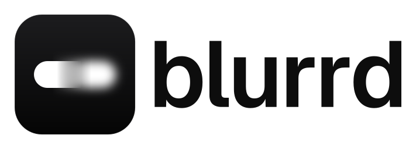

<p align="center">
  <picture>
    <source media="(prefers-color-scheme: dark)" srcset="assets/brand/blurrd-lockup-on-dark.svg">
    
  </picture>
</p>

<p align="center">Blur player names in gameplay recordings: fast, on your GPU, fully offline.</p>

blurrd is a Windows desktop app, plus a command-line tool, that finds the
player names in a VALORANT recording, covers them with tight, soft-edged
blur boxes that follow every animation, checks the result with OCR and
exports a video with the same resolution, frame rate, timestamps and audio
as the source.

> **Status:** the first release, v0.1.0, is being prepared and has not
> been published yet. Until it is, build blurrd from source (see
> [Building from source](#building-from-source)).

## Features

- **Names in the HUD and on the game's screens:** the kill feed, the
  ACE/clutch round banner, the voice-chat speaker, the text-chat sender,
  the scoreboard, the death recap, the spectating widget and the
  match-end/MVP screens. Pick all of them or only some.
- **Boxes that follow the HUD:** rows that slide in, stack, wipe and fade
  stay covered from their first to their last visible frame. The blur
  has a soft edge, a minimum block size and noise, so names cannot simply
  be sharpened back.
- **Checked with OCR:** during the analysis, OCR reads the names on the
  source and then the blurred result exactly as the export will show it.
  A name that stays readable gets an extra box; an output that cannot be
  shown to be clean is named `*_UNVERIFIED` until you check it.
- **Review and edit:** the app previews the blur on the video (before,
  after or split, frame stepping, a box overlay and a timeline that marks
  every region and the verification). Add, move or hide boxes; edited
  frames are checked again before the export.
- **Faithful export:** same resolution, frame rate, timestamps and
  keyframes; audio and subtitles copied packet for packet; recorder
  metadata removed. H.264, HEVC or AV1 through NVIDIA NVENC, AMD AMF,
  Intel Quick Sync or Windows Media Foundation, chosen automatically.
- **Structure-based detection:** names are found from the layout of the
  HUD, not from fixed colours or pixel positions, so the same code covers
  custom highlight colours, colour filters (greyscale, saturation, gamma,
  vibrance, sharpening), other resolutions (720p to 4K) and other aspect
  ratios (4:3 stretched or pillarboxed, 16:10).
- **Offline and private:** no account, no telemetry, no network access.
  Reports and logs never contain the text OCR read.
- **Batch and command line:** export many files in one queue, or script
  everything with the `blurrd` command-line tool.

## What blurrd blurs, and what it does not

blurrd blurs player names in the supported HUD regions (kill feed,
ACE/clutch banner, voice-chat speaker, text-chat sender) and on the
scoreboard, the death recap, the "Spectating" banner and the match-end/MVP
screens, and checks the result with OCR. Name tags above players' heads in
the game world are not blurred. Voice audio is not anonymised. Never
publish a file marked UNVERIFIED without checking it.

**Not blurred in v0.1:**

- name tags above players' heads in the game world;
- the buy-phase loadout cards (name and credits) above teammates' heads;
- voice audio, and anything outside the picture, such as file names.

A later release will handle the world-space name tags and the loadout
cards. Names that OCR sees outside every supported region are listed in
the report as "out of scope"; they never change the result.

blurrd was verified on real 1080p60 recordings. Other resolutions, aspect
ratios and colour settings were tested on variants made from those
recordings, and some cases have no test footage at all.
[docs/privacy.md](docs/privacy.md) lists every case as verified or not
verified and explains the limits of the OCR check and what blurrd stores
on your computer.

## System requirements

- Windows 11 x64. Windows 10 22H2 is expected to work but is not tested.
- Any x86-64 CPU that runs Windows 11: the bundled OCR runtime picks its
  CPU instructions at run time and was verified on an emulated CPU
  without SSE4 or AVX.
- A GPU is optional. Exports use NVENC, AMF or Quick Sync when the GPU
  has them and fall back to Media Foundation, which every Windows
  installation has. OCR runs on DirectX 12 GPUs through DirectML and
  falls back to the CPU. blurrd was developed and measured on NVIDIA
  hardware; the AMD and Intel encoders are supported through FFmpeg but
  have not been tested on their hardware.
- The Microsoft Edge WebView2 runtime, which Windows 11 includes; the
  installer adds it when it is missing.

## Install

Download `blurrd_<version>_x64-setup.exe` from the
[releases page](https://github.com/KonBuku/blurrd/releases) and run it.
It installs blurrd for the current user and needs no administrator
rights.

The installer is not code-signed, so Windows SmartScreen shows "Windows
protected your PC" when you start it. Check the file as described below,
then click **More info** and **Run anyway**.

Each release lists the SHA-256 checksum of every file. Compare it with the
checksum of your download in PowerShell:

```powershell
Get-FileHash .\blurrd_0.1.0_x64-setup.exe -Algorithm SHA256
```

Each release also carries a build provenance attestation: a signed
statement that the installer was built by this repository's release
workflow from the tagged commit. Check it with the
[GitHub CLI](https://cli.github.com):

```powershell
gh attestation verify .\blurrd_0.1.0_x64-setup.exe --repo KonBuku/blurrd
```

## Usage

### Desktop app

1. **Add recordings:** drop files or folders onto the window, or use
   Browse files and Add folder (Ctrl+O, Ctrl+Shift+O).
2. **Choose what to blur:** the inspector's Blur tab has a switch per
   region and the blur style and strength; the Export tab has the codec,
   quality, output folder and file name (by default `<name>_blurrd.mp4`
   next to the recording).
3. **Analyze and review:** play or step through the preview, switch
   between Before, After and Split, and watch the timeline's Verify lane
   (green: checked clean, hatched: not verified yet, red: open leak).
4. **Fix what you see:** M starts the manual box tool, Delete hides a
   detector box, Ctrl+Z undoes.
5. **Export** (Ctrl+E), or select several files and use "Export N files".

### Command line

```powershell
blurrd run match.mp4 -o match_blurrd.mp4        # analyse, verify and blur in one pass
blurrd analyze match.mp4 -o match.blurrd.json   # analyse and verify, save the project
blurrd render match.mp4 --plan match.blurrd.json -o match_blurrd.mp4
blurrd audit match.mp4 --plan match.blurrd.json -o match_blurrd.mp4
```

When a result cannot be verified, the output is named
`match_blurrd_UNVERIFIED.mp4` and the exit code is 3.
[docs/cli.md](docs/cli.md) describes every command and option, the JSON
output and the exit codes.

## Performance

Measured on 2026-10-17 with a release build on an NVIDIA GeForce RTX 4080
SUPER and an AMD Ryzen 7 7800X3D, for a 60-second 1080p60 H.264 recording
(3,601 frames); wall-clock time of the command-line tool, including its
start and exit:

| Command                                             | Time                |
| --------------------------------------------------- | ------------------- |
| `blurrd run`: analysis, OCR verification and export | 9.9–10.3 s          |
| `blurrd run --no-verify`: analysis and export only  | 5.9–6.1 s           |
| `blurrd analyze` with OCR verification              | 8.2–8.8 s           |
| `blurrd render`: H.264 export on two NVENC sessions | 4.3 s (830–870 fps) |
| `blurrd audit`: OCR over the exported file          | 32–38 s             |

Inside those times, the analysis runs at 450–500 frames per second with
OCR and at 800–890 frames per second without it.

When the verification adds boxes to a streamed export, only the parts
with new boxes are encoded again (10.4–11.8 s in total). In the app, the
check of a 2-second range after an edit takes 1.9–2.7 s (about 4 s for
the first check after the app starts). Without a GPU, decoding, OCR and
encoding run on the CPU and take considerably longer.

## Documentation

- [Command-line interface](docs/cli.md)
- [Privacy and verification](docs/privacy.md): what is blurred, verified
  and unverified cases, what blurrd stores
- [Architecture](docs/architecture.md): how the engine and the app work
- [Development](docs/development.md): building, testing and checking
- [Licensing](docs/licensing.md): licences of the code and of the shipped
  components

## Building from source

blurrd builds on Windows 11 with Rust, LLVM, Node.js and pnpm;
[docs/development.md](docs/development.md) lists the exact versions and
explains how to run the desktop app from a checkout. To build and use the
command-line tool:

```powershell
cargo xtask fetch-ffmpeg   # the pinned FFmpeg build (LGPL)
cargo xtask fetch-ort      # ONNX Runtime with DirectML
cargo xtask fetch-models   # the OCR models
cargo run --release -p blurrd-cli -- run match.mp4 -o match_blurrd.mp4
```

## Contributing

Contributions are welcome; please read the [contributing guide](CONTRIBUTING.md)
and the [Code of Conduct](CODE_OF_CONDUCT.md) first. Report security problems
as described in the [security policy](SECURITY.md).

## License

blurrd is licensed under the [GNU General Public License 3.0 only](LICENSE). See
[NOTICE](NOTICE) for attribution and
[THIRD-PARTY-NOTICES.md](THIRD-PARTY-NOTICES.md) for the components it
ships.

## Legal

blurrd is an independent open-source project and is not affiliated with,
endorsed, sponsored or approved by Riot Games, Inc. VALORANT and Riot Games
are trademarks or registered trademarks of Riot Games, Inc. NVIDIA and
NVENC are trademarks of NVIDIA Corporation. FFmpeg is a trademark of
Fabrice Bellard, originator of the FFmpeg project.
